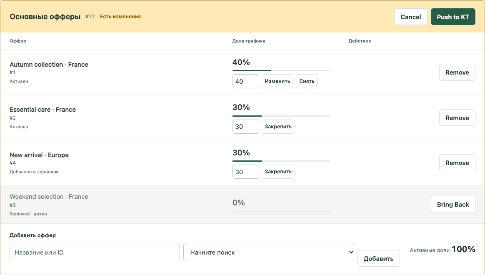

# Keitaro Wrapper

Редактор кампаний Keitaro с локальными черновиками. Создавайте и импортируйте
кампании, меняйте офферы и распределение трафика, затем публикуйте изменения
через **Push to KT**.



*Работающее приложение, демонстрационные данные. [Остальные экраны](docs/assets/screenshots/README.md).*

## Что умеет

- Создавать кампанию с геопотоком и потоком офферов, импортировать существующую.
- Искать офферы, закреплять доли и распределять остаток до 100%.
- Сохранять черновик между сеансами, отменять правки и возвращать офферы из архива.
- Проверять внешние изменения перед Push и сохранять черновик при конфликте.
- Отслеживать результат команды и повторять запрос с тем же ключом идемпотентности.

**Стек:** Python 3.13 · FastAPI · PostgreSQL 17 · SQLAlchemy · Vanilla JS.
Backend разделён на домен, application и адаптеры — [архитектура](docs/specs/002-technical-design.md).

## Быстрый запуск

Нужен Docker Compose.

```sh
cp .env.example .env
```

В `.env` укажите `KEITARO_BASE_URL` (HTTPS, без `/admin`), `KEITARO_API_KEY`,
а также разные случайные `POSTGRES_PASSWORD` и `APP_SECRET_KEY`
(от 32 символов; пароль БД — URL-safe).

```sh
docker compose build
docker compose up -d db
docker compose run --rm app alembic upgrade head
docker compose up -d app
```

Откройте **<http://127.0.0.1:8000>**. Остановка: `docker compose down`, данные сохранятся.
Для создания кампаний дополнительно нужны ID справочников и
[проверенный профиль Keitaro](docs/guides/operations.md). Сервис рассчитан на локальный запуск.

## Проверки

**115 автотестов прошли**, браузерные сценарии — тоже. На Keitaro 11.5.0 проверены
импорт, создание кампании, Push, архив, Bring Back и обработка конфликта.
Живая проверка использовала один доступный оффер; распределение между несколькими
проверено на синтетических данных. [Результаты и ограничения](docs/guides/validation.md).

```sh
uv sync --locked
uv run pytest tests/unit -q
```

[Полный набор тестов и браузерные проверки](docs/guides/development.md).

## Документация

[ТЗ](docs/specs/000-requirements.md) · [Развёртывание](docs/guides/deployment.md) ·
[Работа редактора](docs/guides/operations.md) · [Все документы](docs/README.md)
