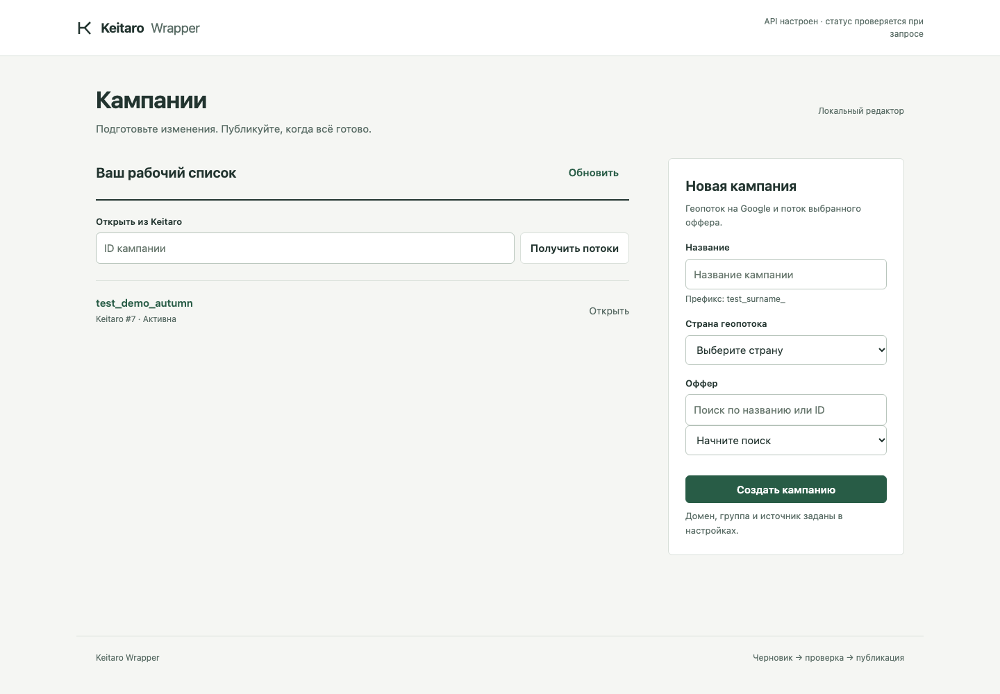
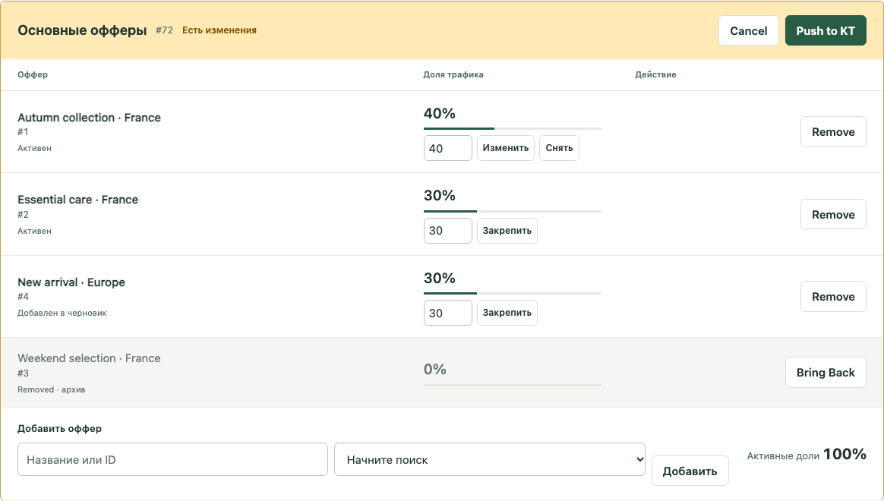
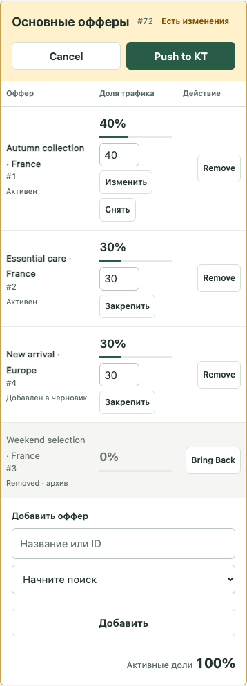

# Экраны приложения

[Главная](../../../README.md) · [Результаты проверки](../../guides/validation.md)

Снято в Chromium 18 ноября 2026 года. Это интерфейс работающего приложения
с PostgreSQL и синтетическим Keitaro. Кампании и офферы демонстрационные.
Текст, статусы и доли на изображениях не дорисованы.

## Кампании и создание

Импорт по ID, список локальных кампаний и форма создания.



## Редактор офферов

Первому офферу закреплены 40%, остаток распределён поровну. Новый оффер
добавлен в черновик; удалённая привязка доступна в архиве через Bring Back.
Состояние сохранено в БД и показано после перезагрузки страницы.



[Полная страница кампании с геопотоком и историей операций](campaign.png).

## Мобильный экран

Ширина окна — 390 px. Показана область редактора целиком.



## Повторить съёмку

Запустите чистый браузерный стенд по [инструкции](../../guides/development.md),
затем выполните из корня репозитория:

```sh
uv run python -m tests.browser.showcase
```

Сценарий выполняет действия через интерфейс и сохраняет PNG в эту папку.
Перед повтором перезапустите тестовый сервер, чтобы восстановить исходные данные.
