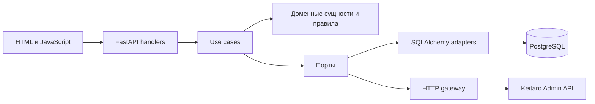

# Техническая спецификация

Дата: 18 ноября 2026 года.
Основание: [ТЗ](000-requirements.md) и [проверка контракта Keitaro](001-keitaro-contract.md).
Статус: локальная реализация подготовлена; совместимость
живого HTTP-адаптера ограничена проверками K-01–K-05.

## 1. Решение

Одно FastAPI-приложение обслуживает HTML и JSON API. PostgreSQL хранит локальное
состояние редактора и операции; Keitaro остаётся источником опубликованной
конфигурации. Никакого автоматического двустороннего слияния нет.

Выбранные линии стека: Python 3.13, FastAPI с Pydantic 2, SQLAlchemy 2.0 async,
asyncpg, Alembic, PostgreSQL 17, httpx, Jinja2. Зависимости фиксируются lock-файлом
uv; здесь не дублируются точные patch-версии из lock-файла.
pytest, pytest-asyncio и pytest-httpx используются для проверок, Playwright —
для браузерного сценария с синтетическим адаптером.

Первая поставка — один процесс приложения, один Uvicorn worker и одна БД.
Операции выполняются в HTTP-запросе, без очереди и фонового worker. Журнал
операций нужен для восстановления, а не является неявной очередью задач.

Стрелки показывают поток работы. Зависимости кода адаптеров направлены
к портам application-слоя; домен не импортирует application или инфраструктуру.

## 2. Границы ответственности

| Компонент | Ответственность |
| --- | --- |
| Campaign | Локальная идентичность, связь с Keitaro, ревизия и доступность кампании |
| StreamEditor | База, черновик и архив одного потока; доменные операции D-03–D-06 |
| OfferAllocation | Привязка оффера, вес, закрепление; не сама сущность оффера Keitaro |
| WeightDistribution | Детерминированный перерасчёт и проверка инвариантов D-04 |
| Operation | Принятая команда, её этап, результат и возможность безопасного продолжения |
| Use cases | Оркестрация сущностей и портов, короткие транзакции, вызовы gateway |
| ORM services | Сохранение агрегатов, версии и ограничения PostgreSQL |
| Keitaro gateway | Аутентификация, JSON mapping, HTTP-ошибки, нормализация внешнего состояния |
| HTTP API | Валидация входа, версия клиента, mapping ошибок и результатов |

Порты: отдельные репозитории `ICampaigns`, `IStreams`, `IOperations`,
`IOfferCatalog`; общий `IUnitOfWork` одной транзакции, `ITransactions` и
`ITransactionContext`; типизированный `IKeitaroGateway` и `IClock`.
Идентификаторы создаёт общий генератор UUID.
Не вводить универсальный репозиторий, шину событий или собственный DI-фреймворк.
Зависимости связываются явными фабриками в composition root и внедряются
через FastAPI dependencies; домен не вызывает контейнер.

Основные use cases: создание/импорт кампании, получение редактора, Fetch,
добавление/удаление/восстановление привязки, изменение закрепления, Cancel,
Push, сверка и продолжение операции. Команда и результат находятся рядом
с соответствующим use case.

### Организация модулей и HTTP-схемы

- `domain/{campaigns,streams,operations}` — сущности, состояния и инварианты.
- `application/{campaigns,streams,offers,operations}` — сценарии и типизированные
  dataclass DTO; `application/ports` — контракты адаптеров, `application/common` —
  политика команд, дедлайны, восстановление и синхронизация.
- `infrastructure/persistence` — предметные репозитории, Unit of Work, модели по предметным
  модулям и Alembic; `infrastructure/keitaro` — HTTP gateway.
- `api/v1/<module>` — отдельные handlers, In/Out-схемы и depends. Общие схемы
  пагинации, ревизии, ошибки и базовые In/Out находятся в `api/common`.
- `bootstrap` — только сборка зависимостей и жизненный цикл; `main.py` — фабрика
  приложения. Исполнение команд принадлежит `application/common/execution.py`.

Handlers получают конкретные use cases через depends и не открывают транзакции.
Чтение редактора, операций и списков возвращает application DTO; API преобразует
их в Out-модели и проверяет через `response_model`. Поля вложенных результатов
операций явно перечислены в OpenAPI. Сырые context/payload в HTTP-модели не входят.
Порт Keitaro передаёт `RemoteCampaign`, `RemoteStream`, `RemoteOffer`,
`CreationSettings`, `CreationPlan`, `PreparedWrite`, `WriteResult` и `RecoveryMatch`.
Адаптер собирает внешний JSON, проверяет соответствие созданных объектов,
сравнивает конфигурации и ищет результат неизвестной записи. Application
управляет последовательностью, транзакциями и решением о допустимости записи.
Внутренние слои не читают поля JSON Keitaro: полный внешний снимок переносится
как неизменяемый непрозрачный `Snapshot`. Его декодируют только адаптеры.
`Document` остаётся для JSON адаптеров и внутренних payload/context/result журнала;
он не заменяет HTTP-схемы или DTO внешнего порта.

Проекции привязок формирует application. StreamEditor принимает имя, позицию,
типизированные привязки и непрозрачный снимок; проверяет восстановление из архива
и инварианты публикации. В домене нет сериализаторов ORM или HTTP.

Operation отклоняет неизвестные статусы, изменение checkpoint завершённой
попытки и прямой переход обратно в running. Возврат в running выполняется
через `begin_control`: resume разрешён после failed/partial, reconcile/resolve —
после unknown/manual_review, только для поддерживаемых резервирующих операций.
Partial разрешён только созданию. Завершённый succeeded/conflict не возобновляется.
Время создания, checkpoint и переходов передаётся явно; use cases получают IClock.

SQLAlchemy IntegrityError преобразуется persistence-адаптером в ошибку
`concurrent_change`; API не зависит от типов исключений ORM. Применённая начальная
миграция перемещена вместе с Alembic без изменения содержимого или revision ID.
Формат таблиц не меняется. Persistence читает прежние JSONB-контрольные точки:
старый список offers операции Push преобразуется во внутреннюю подготовленную
публикацию и список ID. Снимки сохраняются обычным JSON, без полей реализации
dataclass. Восстановление старых операций после перезапуска проверяется отдельно.

### Общая пагинация

Application использует `Pagination(limit, offset)` и `Page[T]`. API использует
`PaginationIn` и `PageOut[T]`: `items`, `total`, `limit`, `offset`, `has_more`.
`total` — число результатов до среза; для офферов — после фильтра поиска.
`has_more` означает наличие результатов за возвращённой страницей. Пустая страница
за концом списка сохраняет фактический total и возвращает `has_more: false`.
Допустимы limit 1–100 и offset ≥ 0; default limit кампаний 100, офферов 20.
Оба параметра передаются через query string, без тела GET-запроса.

## 3. Идентичность и модель хранения

Локальная кампания имеет UUID, поскольку появляется до получения внешнего ID.
Поток идентифицируется его положительным ID Keitaro; оффер — ID Keitaro.
UUID операции создаёт клиент как ключ команды; собственные UUID объектов
генерируются через общий provider. Смена экземпляра Keitaro при существующих
данных запрещена: БД привязана к одному origin интеграции.

| Таблица | Основные данные и ограничения |
| --- | --- |
| integration_binding | Единственная запись с origin Keitaro; без API-ключа |
| campaigns | UUID PK, внешний ID nullable unique, имя, alias, состояние, revision, last_fetched_at, даты |
| stream_editors | ID потока PK, FK кампании, имя/позиция, доступность, причина read-only, revision, три снимка ниже |
| offer_catalog | ID оффера PK, последнее имя и внешнее состояние, время обновления; без URL и payout-данных |
| operations | UUID PK, kind, campaign_id, stream_id nullable, request fingerprint, expected revision, собственная revision, reserves_campaign, status, result/error, даты |
| operation_attempts | UUID PK, FK операции, последовательный номер, этап, состояние отправки, ожидаемый результат, подтверждённые внешние ID |

В `stream_editors` сохраняются JSONB-снимки:

- `remote_baseline` — последнее подтверждённое внешнее состояние, достаточное
  для проверки конфликтов. Оно никогда целиком не отправляется обратно.
- `editor_baseline` — активные и архивные привязки с весами, закреплениями
  и последними известными названиями на момент синхронизации.
- `editor_draft` — текущее локальное состояние той же модели.

Снимки имеют версию формата. Для ключей привязок используется ID оффера,
что исключает дубликаты внутри агрегата. JSONB выбран потому, что состав
потока меняется атомарно как целое; отдельный SQL update одной доли был бы
неправильной границей инварианта. Проверки сумм и закреплений выполняет домен.
Тип JSON-объекта, положительные ID, FK и уникальность обеспечиваются также БД.

Архив — часть агрегата, а не запись об удалении глобального оффера. Каталог
можно обновлять независимо: потеря оффера из кеша не удаляет архив.
Отличие новой привязки определяется её отсутствием в `editor_baseline`.
Cancel восстанавливает снимок целиком, не реконструирует его по истории событий.
Dirty вычисляется по семантическому сравнению базы и черновика, не хранится
вторым независимым булевым источником истины.

Для частичного создания сохраняются входные настройки и внешние ID каждого
подтверждённого шага. API-ключ, пароль и заголовки авторизации не входят
в snapshots или операции. Технические ответы хранятся только в необходимом
объёме; пользовательские строки и URL не пишутся в обычные логи.

## 4. Версии и транзакции

Все изменения в одной кампании сериализуются. Это намеренное ограничение
первого выпуска: Push одного потока временно блокирует редактирование остальных
потоков этой кампании, но не других кампаний.

Локальная команда в одной транзакции блокирует строку кампании, проверяет
отсутствие активной внешней операции и ожидаемую ревизию, изменяет агрегат,
повышает ревизии и сохраняет результат команды. Порядок блокировок всегда
campaign → stream. Публикация и импорт принимаются с той же защитой.

Внешняя операция имеет три границы:

1. Короткая транзакция принимает команду, резервирует кампанию и записывает
   ожидаемое состояние. Только после commit возможен сетевой вызов.
2. HTTP выполняется без открытой транзакции БД. Перед каждым запросом записи
   попытка помечается как отправляемая в отдельной короткой транзакции.
3. Другая короткая транзакция проверяет владельца резерва и ревизии, фиксирует
   подтверждённый результат либо состояние ошибки/неопределённости.

Частичный unique index на активных operations с reserves_campaign по campaign_id защищает резерв
даже при ошибке в коде. Для импорта уникальность external campaign ID защищает
от дублирования кампании двумя запросами. Ревизия кампании меняется при любом
изменении её редактора; ревизия потока — при изменении этого потока.

Один AsyncSession принадлежит одной транзакционной работе и не разделяется
между параллельными задачами. После транзакции наружу возвращаются доменные
объекты, не ORM-сущности с lazy loading.
[Модель async-сессии SQLAlchemy](https://docs.sqlalchemy.org/en/20/orm/extensions/asyncio.html).

## 5. Локальное и внешнее состояние

### 5.1. Fetch

Fetch принимает ожидаемую ревизию кампании и резервирует её. При наличии
черновика, выполняющейся записи или неизвестного исхода отклоняется.
Данные кампании и потоков сначала читаются полностью, затем принимаются
одной локальной транзакцией. Ошибка до принятия оставляет прежнюю базу.

Обновление привязок выполняет правила D-06; исчезнувшие потоки отмечаются
недоступными. Внешнее отсутствие объекта подтверждает только корректный ответ
об отсутствии, а не 401, 403, timeout или ошибка разбора ответа.
Каталог офферов не обязан содержать каждый исторический оффер: при необходимости
используются последнее известное имя и ID.

Атомарность локального принятия не означает snapshot isolation в Keitaro:
внешние данные могли меняться между GET. Push повторно проверяет свой поток.

### 5.2. Совместимость редактора

Редактируются распознанные потоки офферов с целыми весами, уникальными ID,
поддерживаемым внешним состоянием всех привязок и обычной схемой распределения.
Неизвестная структура, отключённые привязки или дополнительные неподдерживаемые
поля связи делают поток read-only: PUT мог бы потерять эти данные.

Редиректные потоки остаются непрозрачными для интерфейса. Нужные для проверки
конфликта настройки хранятся как внешний снимок, но не превращаются в
редактируемые поля формы. Если поток офферов сменил схему, уже известные
привязки сохраняются по D-03, а восстановление блокируется.

### 5.3. Проверка конфликта

Gateway строит каноническое представление конфигурации потока. Оно учитывает
состав, share/state, тип, схему, позицию, действие, фильтры, лендинги,
триггеры и остальные значимые настройки. Оно исключает только явно известные
производные поля: статистику, timestamps и технические ID записей привязок.
Порядок словарных ключей и офферов нормализуется; порядок иных массивов
сохраняется, если его незначимость не подтверждена контрактом. Для `landings`
пустые `action_payload: null` и `action_payload: ""` равнозначны: Keitaro 11.5.0
нормализует поле при PUT только с `offers`. Непустые значения и payload
редиректных потоков сравниваются строго.

Неизвестное поле не игнорируется автоматически. Если его семантика неясна,
поток становится несовместимым для записи. Локальные закрепления не входят
в удалённое сравнение. Внешние изменения названий офферов из каталога не
считаются изменением маршрутизации потока.

### 5.4. Push

Push принимает ожидаемую ревизию потока и фиксирует неизменяемое желаемое
состояние операции. Gateway перечитывает поток и доступность активных офферов.
Отличие от remote baseline приводит к конфликту без PUT.

При совместимости gateway отправляет только полный желаемый массив `offers`,
затем сверяет состав/веса и нетронутые настройки с ожидаемым состоянием.
Отсутствующие привязки должны быть удалены из потока, а не отключены: это
проверяется K-03. Если изменились только закрепления, после проверки базы
достаточно локального подтверждения без PUT.

Успешная сверка атомарно обновляет remote baseline, editor baseline и draft,
сохраняет архив и завершает операцию. Конфликт сохраняет черновик.
Пользователь разрешает его через Cancel и Fetch по D-07.

Сравнение перед записью не закрывает гонку с внешним редактором между GET
и PUT. Без условной записи в API приложение обнаруживает многие конфликты,
но не обещает полную защиту от потерянного внешнего обновления.

## 6. Идемпотентность и восстановление

### 6.1. Контракт команды

Каждая команда изменения имеет `Idempotency-Key` UUID. Ключ сохраняется
вместе с видом команды, нормализованным телом и результатом принятия.
Повтор с тем же содержимым возвращает ту же операцию, не выполняя действие
повторно. Повтор с другим содержимым — конфликт ключа. Поиск прежней команды
происходит до проверки текущей ревизии, чтобы корректный retry не ломался
из-за уже применённого первого запроса.

Ошибки входной валидации до принятия команды не создают операцию.
Для повтора завершённой неудачей внешней операции используется явное Resume,
а не повтор исходного POST с новым ключом. Идемпотентность нашего API
не является идемпотентностью Keitaro.
Resume повторно проверяет ревизии и неизменность сохранённых входных данных.
Если после определённого отказа пользователь уже изменил черновик, старую
операцию продолжать нельзя: требуется новая команда для нового состояния.

### 6.2. Состояния операции

| Состояние | Смысл и доступные действия |
| --- | --- |
| running | Команда принята и исполняется; повтор возвращает её ID |
| succeeded | Результат подтверждён и принят локально |
| failed | Известная ошибка, не оставившая неопределённой записи; черновик сохранён |
| conflict | Удалённое состояние отличается; требуется Cancel/Fetch |
| partial | Некоторые шаги создания подтверждены, следующий определённо не выполнен; можно Resume |
| unknown | Запись могла выполниться; разрешена только сверка |
| manual_review | Автоматически определить исход нельзя; резерв сохраняется |

`running`, `unknown`, `manual_review` и незавершённое `partial` удерживают резерв.
Cancel недоступен, пока существует возможность незавершённой удалённой записи.

Перед отправкой сохраняется попытка с видом запроса и ожидаемым результатом.
Crash между этой записью и фактической отправкой трактуется консервативно как
неопределённость. При старте единственного процесса оставшиеся `running`
от предыдущего процесса переводятся в `unknown`; записи не повторяются.
Истечение времени не снимает резерв и не является доказательством завершения.

### 6.3. Сверка и ручное разрешение

Reconcile выполняет только чтение. Точное совпадение с ожидаемым результатом
позволяет завершить соответствующий шаг. Возврат прежнего состояния ещё
не доказывает отказ: исходный запрос может продолжать выполняться.
При невозможности доказать завершение требуется manual_review, даже если
несколько GET подряд вернули прежнее состояние.

Для ручного разрешения интерфейс показывает ID операции, этап и известные
внешние ID. Оператор проверяет отсутствие выполняющегося запроса на стороне
Keitaro. Отдельное подтверждаемое действие принимает `expected_operation_revision`,
решение «принять текущее внешнее состояние» или «подтверждённо не выполнено»
и пояснение оператора. Перед фиксацией приложение снова читает внешний объект.
Для частичного создания решение «не выполнено» относится только к текущей
попытке, не забывает уже созданные объекты. Несовместимое с наблюдаемым
состоянием решение отклоняется.
Принятие текущего состояния для Push явно сбрасывает соответствующий черновик;
интерфейс предупреждает об этом до подтверждения. Для Create ручная сверка
принимает найденные ID и завершённые этапы, но не переводит неполную или
выключенную кампанию в succeeded: остаётся partial до завершения всех условий.

Ручное подтверждение является явным решением оператора, а не технической
гарантией API. Автоматического force push, очистки резерва SQL-командой
или скрытого повторного POST нет.

## 7. Создание кампании

Create принимает нормализованное имя, код страны, ID оффера и ключ команды.
Настройки домена, группы, источника и префикса проверяются до первого POST.
Операция сохраняет их снимок: смена конфигурации приложения не меняет
параметры уже начатой операции.

Кампания создаётся выключенной. Затем создаются геопоток и поток офферов,
проверяется их содержимое и только после этого кампания включается.
Завершение включает импорт в локальный редактор. Если активация произошла,
а финальное локальное сохранение не удалось, операция остаётся восстанавливаемой;
пользователь не получает ложного сообщения об отмене.

Для кампании заранее генерируется стабильный alias, связанный с UUID операции;
в notes/comments создаваемых объектов сохраняется служебный идентификатор
операции и роли потока. Он не содержит секретов. Название кампании соответствует
пользовательскому префиксу. Эти маркеры помогают найти положительный результат
после timeout, но сами по себе не доказывают отсутствие записи.

При продолжении используются сохранённые внешние ID. Если ID неизвестен,
сверка ищет точное совпадение маркера и ожидаемых полей среди доступных объектов.
Ноль совпадений при неизвестном исходе не даёт права повторить POST;
несколько совпадений требуют ручной проверки. Автоматической компенсации
удалением созданной кампании нет.

Контракты payload геофильтра и редиректа завершаются по K-02. Частично
придуманная структура не используется как рабочая. Ссылка строится из
подтверждённого привязанного домена и alias; параметры источника учитываются
после K-05. Получать эту ссылку GET-запросом для проверки не нужно: это создало
бы трекинговый переход и изменило статистику.

## 8. JSON API приложения

База — `/api/v1`. `campaign_id` ниже означает локальный UUID,
`stream_id` — ID потока Keitaro, `operation_id` — UUID операции.
Имена и ID Keitaro в ответах различаются явно.

| Метод и путь | Контракт |
| --- | --- |
| `GET /bootstrap` | Публичные настройки формы, CSRF-token, доступность интеграции; без ключа |
| `GET /campaigns` | Локальные кампании, пагинация limit/offset |
| `POST /campaigns` | name, country_code, offer_id; создание и ID операции |
| `POST /campaigns/import` | keitaro_campaign_id; первоначальный Fetch или ссылка на уже импортированную кампанию |
| `GET /campaigns/{campaign_id}` | Кампания, потоки, ревизии, состояния и разрешённые действия |
| `POST /campaigns/{campaign_id}/fetch` | expected_revision кампании; обновление по D-06 |
| `GET /offers` | q, limit, offset; поиск по очищенному каталогу |
| `POST /streams/{stream_id}/offers` | offer_id, expected_revision; Add или Bring Back архивной привязки |
| `POST /streams/{stream_id}/offers/{offer_id}/remove` | expected_revision; Remove |
| `POST /streams/{stream_id}/offers/{offer_id}/restore` | expected_revision; Bring Back |
| `PUT /streams/{stream_id}/offers/{offer_id}/pin` | pinned, weight при pinned=true, expected_revision |
| `POST /streams/{stream_id}/cancel` | expected_revision; восстановление локальной базы |
| `POST /streams/{stream_id}/push` | expected_revision; публикация потока |
| `GET /operations/{operation_id}` | Состояние, ревизия, этап, результат, доступные действия |
| `POST /operations/{operation_id}/reconcile` | expected_operation_revision; только внешнее чтение |
| `POST /operations/{operation_id}/resume` | expected_operation_revision; только доказанно безопасное продолжение |
| `POST /operations/{operation_id}/resolve` | expected_operation_revision, decision, confirmation, note; ручное разрешение по §6.3 |

Все команды изменения, включая reconcile/resume/resolve, требуют ключ команды.
Операция управления имеет собственную квитанцию идемпотентности и ссылается
на исходную операцию; она не получает второй резерв той же кампании.
При чтении квитанции управления `parent_operation_id` указывает на исходную
операцию. Клиент проверяет её результат, а не считает успешную квитанцию
управления подтверждением внешней записи. Для прочих операций поле равно null.
Обычные GET не запускают сверку или публикацию.

Ответ редактора содержит базовые данные кампании, campaign revision и для каждого
потока: stream revision, dirty, доступность, причину ограничения, связанные
операции, сумму активных весов и привязки с ID/name/weight/pinned/status.
Сырые снимки Keitaro наружу не возвращаются. Мутация возвращает обновлённый
редактор или ID операции; клиент никогда не считает свои веса авторитетными.

Успех — 200, новое создание/импорт — 201. Принятая операция с ещё неизвестным
исходом возвращает 202 и operation_id; это не означает наличие фонового worker.
При потерянном HTTP-ответе клиент получает операцию по своему ключу, без новой команды.

Ошибки имеют `error.code`, безопасное `message`, `details`, `operation_id` при
его наличии и `request_id`. Коды: 404 — локальный объект отсутствует;
409 — stale revision, занятость, конфликт, повторный активный оффер или иной
конфликт состояния; 422 — вход/недопустимое распределение;
502 — некорректный ответ/отказ интеграции; 503 — недоступная конфигурация или сеть.
Неопределённая принятая запись возвращается как операция 202, а не как обычный
retryable 503. Внешние 401/403 не превращаются в запрос входа пользователя
в наш интерфейс; они означают ошибку настройки или прав интеграции.

Отказ до сохранения команды сопровождается `error.details.command_state =
"not_started"`. Неопределённая серверная ошибка без квитанции не очищает ключ
команды в браузере. Ошибка повторного запроса не доказывает отказ исходного,
поэтому ключ повторяемой команды сохраняется до получения её квитанции.
Ошибка обновления экрана после подтверждённой команды не меняет её результат.

## 9. HTTP gateway и каталог

Один httpx.AsyncClient создаётся в lifespan и закрывается при завершении.
Ключ передаётся только configured origin по TLS, не в query string.
Автоматические редиректы отключены. Значения URL, заголовков и bodies не логируются.
Для тестов gateway получает transport через DI.

Timeout задаётся явно по фазам connect/read/write/pool; дополнительно ограничено
полное время операции. Отмена после начала записи считается неопределённым
результатом. Фазовые timeout поддерживаются HTTPX; они не равны общему дедлайну.
[Timeout HTTPX](https://www.python-httpx.org/advanced/timeouts/).

GET допускает ограниченный retry временных ошибок. POST/PUT не повторяются
автоматически ни клиентом, ни транспортом. Ошибка до отправки может считаться
безопасной только если gateway это доказуемо различает; иначе используется unknown.
500 после записи также не доказывает отсутствие изменений.
[Настройки транспорта HTTPX](https://www.python-httpx.org/advanced/transports/).

Каталог кешируется в БД на 60 секунд, обновляется целиком только после успешного
чтения. Поиск использует case-insensitive подстроку имени либо точный ID;
результаты сортируются по имени и ID, default limit 20, max 100.
При устаревшем каталоге и ошибке обновления интерфейс сообщает об ошибке,
а не выдаёт старые данные за актуальные. Перед Add/Restore/Create/Push
доступность соответствующих офферов проверяется независимо от кеша.

## 10. Интерфейс и локальное окружение

Две основные страницы: список/создание кампаний и редактор кампании.
Jinja2 формирует каркас, JavaScript вызывает тот же JSON API. Отдельного
набора бизнес-обработчиков для HTML нет. Все веса рассчитывает backend.

Редактор реализует D-09: статусы подписаны, кнопки зависят от разрешённых действий,
архив отличается от помеченных к удалению строк, ошибки показываются рядом
с операцией. При потере ответа UI сохраняет ключ и открывает состояние операции.
Браузер не повторяет мутации автоматически; обновление страницы перечитывает БД.

Приложение и опубликованный порт Compose слушают loopback. PostgreSQL не
публикуется наружу. CORS не разрешает сторонние origins. Изменяющие запросы
принимают JSON и требуют CSRF-token, связанный с подписанной SameSite-сессией;
проверяются Origin и Host. Это защита локального интерфейса от сторонней страницы,
а не замена аутентификации для публичного развёртывания.
CSRF-token передаётся в заголовке `X-CSRF-Token`. Имена, сообщения интеграции
и данные каталога выводятся с HTML-экранированием; внешний HTML не исполняется.

Конфигурация: DATABASE_URL, KEITARO_BASE_URL, KEITARO_API_KEY,
KEITARO_DOMAIN_ID, KEITARO_GROUP_ID, KEITARO_TRAFFIC_SOURCE_ID,
CAMPAIGN_NAME_PREFIX, APP_SECRET_KEY и HTTP timeout. `.env.example` содержит
только placeholders. Отсутствующий ключ не скрывает сохранённый редактор,
но блокирует действия, требующие Keitaro. Изменение origin при заполненной
БД блокируется проверкой integration_binding.

Дополнительный `KEITARO_CREATION_PROFILE` указывает на локальный JSON-профиль
маршрутизации версии 1: точный origin, отметка выполненной проверки `verified`
и шаблоны geo/fallback. До подтверждения K-02/K-05 создание блокируется до
первой записи. Само наличие профиля не заменяет проверку фактического API.
Страна подставляется вместо `{{country}}`; IDs, порядок, типы, маркеры операции
и офферы задаются use case. При возобновлении сверяются все известные объекты;
несовпадение блокирует дальнейшие записи и требует выяснения результата.

Миграции выполняются отдельной явной командой, не при каждом старте web.
Health liveness проверяет процесс; readiness — БД и применённую схему,
без вызовов Keitaro. Статус интеграции показывается отдельно.

## 11. Проверка решения

| Область | Покрытие и связь с приёмкой |
| --- | --- |
| Домен | Весовые инварианты и округление, все переходы привязок, закрепления, Cancel и dirty: A-04–A-07, A-09 |
| PostgreSQL/use cases | JSONB round-trip, миграции, версии, rollback, резерв, идемпотентность, Fetch и восстановление: A-04, A-07, A-10–A-13 |
| HTTP gateway | Точные URL/method/body, передача ключа, ошибки, отсутствие retry записи, подтверждение состояния: A-01–A-03, A-08, A-12, A-14 |
| HTTP API | Валидация, коды ошибок, ревизии, CSRF, сериализация; минимальный happy path через стек |
| Интерфейс | Создание, Fetch, Add/Remove/Bring Back/Pin, Cancel/Push, состояния конфликтов и неизвестного исхода |
| Запуск | Чистая тестовая БД, миграции, сборка Compose, README: A-15 |

Сценарии отказов моделируются последовательными тестами с gateway doubles
и сохранёнными промежуточными состояниями. Не строить нестабильные гонки
через sleep/threads. Ограничения PostgreSQL и порядок блокировок проверяются
прямыми контрактами и ревью, без обещания исчерпывающего доказательства гонок.
Обычный тестовый запуск не использует живой Keitaro.

K-01–K-05 остаются отдельной проверкой совместимости. До их закрытия нельзя
обозначать приложение как полностью проверенное на выданном экземпляре.
Результаты чтения, разрешённых пробных записей и ограничения фиксируются
в спецификации; рабочие команды и подробные тестовые сценарии — в локальном плане.
